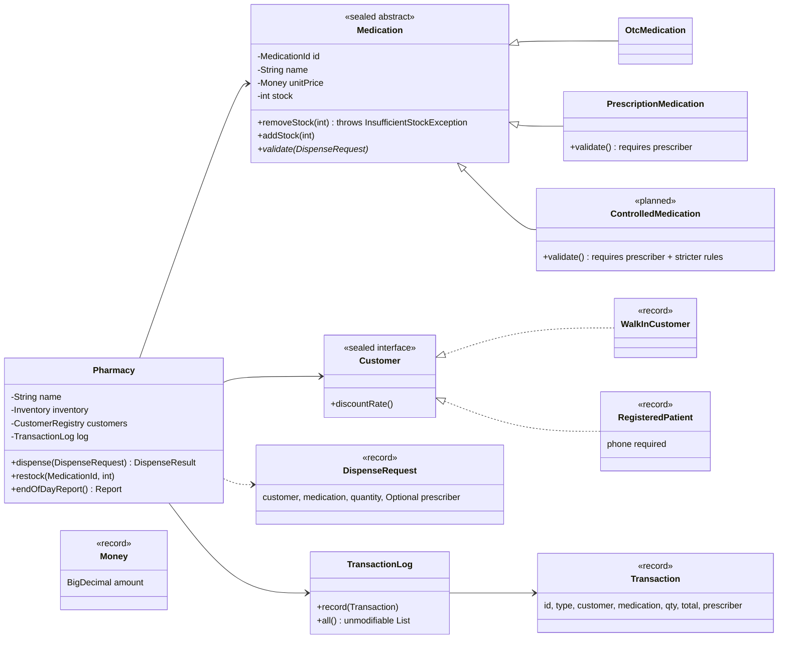

# Diagnosis: Akosua's Pharmacy Stock Tracker


## 1. Current behaviour (baseline)

Output of the original `PharmacyTracker.java`, run unchanged on Java 21:

```
Dispensed 2 x Paracetamol 500mg to Kofi Mensah for GHS 25.0
Dispensed 1 x Amoxicillin 250mg to Ama Owusu (prescribed by Dr. Boateng) for GHS 28.5
Restocked 50 x Paracetamol 500mg
Dispensed 100 x Amoxicillin 250mg to Kofi Mensah (prescribed by Dr. Boateng) for GHS 3000.0

=== Akosua's Pharmacy - end of day ===
Stock levels:
  Paracetamol 500mg (OTC): 148 in stock
  Amoxicillin 250mg (PRESCRIPTION): -61 in stock
Transactions today: 4
```

The rebuild must reproduce this output exactly, with one intended difference: the
last dispense is refused, so Amoxicillin stays at 39 and only 3 transactions are recorded.

## 2. Problems, ranked by risk to this business

### 1. Stock can become invalid, and nothing stops it (most dangerous)

- What: `dispense` subtracts `qty` from stock without checking what's on hand. It
  also accepts zero or negative quantities: dispensing `-5` adds stock and records a
  negative sale. `restock` accepts negative quantities too. The run above ends with
  -61 Amoxicillin.
- Root cause: No object enforces the rule "stock is never negative." `stock` is a
  public field, so any code can set it to anything.

- Business risk: This is the most dangerous problem for a pharmacy. The system
  records a sale of medicine that never physically happened. Reorder decisions, stock audits and any regulatory
  inspection rely on these counts. The count's inaccuracy is a major reason Akosua no longer trusts the system to be correct.

### 2. Prescriptions are checked but never recorded

- What: The prescriber is only printed to the console. `Transaction` and the
  customer's `history` don't store it. The only check is `prescriber == null`, so an
  empty string "" or "   " passes as a valid prescriber.
- Root cause: `Transaction` was modelled as generic name/qty/total strings, with
  no place for dispensing details that depend on the medicine type.
- Business risk: Accordin to the brief, a prescription "has to be recorded." The current codebase has 
  no way of keeping a lasting record of who authorised a
  prescription-only sale. For controlled substances where the prescriber of the medication has to be recorded, that raises a legal compliance issue.

### 3. An unknown category silently creates a ghost sale

- What: `category` and `kind` are free-text strings. A typo such as
  "Prescription" or "CONTROLLED" matches neither branch in `dispense`. Stock is left
  alone and nothing is printed, but the method still writes a history entry and a
  `Transaction` with a total of GHS 0.
- Root cause: Stringly-typed categories with no validation, and an `if/else if`
  chain that has no `else`.
- Business risk: The audit trail says medicine was dispensed for free when it
  wasn't, and nobody is told. Adding the controlled category the naive way (a new
  string) would trigger this bug on day one if any branch were missed.

### 4. No encapsulation: everything can be changed from outside

- What: Every field on `Medication`, `Customer` and `Transaction` is public and
  mutable (name, price, stock, category, id, history). `getTransactions()` returns the
  internal list itself, so any caller can `clear()` or add fake entries to the audit
  trail. `Pharmacy.meds` and `customers` are public too.
- Root cause: Classes are used as plain data bags. No class protects its own state.
- Business risk: This is what makes problems 1–3 impossible to fix properly. Any
  rule added in `Pharmacy` can be bypassed by a direct field write. The transaction log,
  the pharmacy's only evidence of what happened, can be quietly altered.

### 5. All type-specific rules live in one `if/else` in `Pharmacy.dispense`

- What: Pricing, the discount and the stock update are copy-pasted into both
  branches. The rules for every medicine type and every customer type are mixed into
  one method.
- Root cause: Behaviour that belongs to the medicine type (does it need a
  prescriber?) and to the customer type (do they get a discount?) has been pulled out
  into a central `if/else` instead of living with the types.
- Business risk: Adding controlled substances means editing this method,
  duplicating the block a third time and touching code that OTC and prescription sales
  depend on. Each copy can drift: fix the discount in one branch and forget the other.

### 6. Money is held as `double`

- What: Prices and totals are `double` (`0.95 * total`).
- Root cause: Floating-point types can't represent most decimal amounts exactly.
- Business risk: Small rounding errors build up across a day's sales and reports.
  The baseline values happen to print cleanly, but `double` is the wrong type for
  cedis. (Output formatting such as `GHS 25.0` must be preserved, so the fix has to
  keep the printed format identical.)

### 7. Missing basic validation and invariants

- A medication or customer that was never added to the pharmacy can still be dispensed
  to. `dispense` never checks `meds` or `customers`.
- Null customer or medication causes a `NullPointerException` mid-operation.
- A registered patient's phone is set by a public field after construction, so a
  "registered" patient can have no contact details and a walk-in can have some.
- Price and initial stock can be negative.
- Business risk: Bad data gets in without warning, and history is kept for
  patients the pharmacy can't actually contact.

### 8. Structural and hygiene issues (lower risk, high friction)

- One file, no packages: every change touches the same file, so merge conflicts and
  fear of editing are guaranteed.
- `static int counter` IDs are global mutable state shared across instances and not
  thread-safe.
- Business logic writes straight to `System.out`, so the rules can't be tested without
  capturing console output, and the console is the only "log."
- `history` entries and `Transaction.type` are free-text strings.
- No tests, so nobody can prove a change didn't break something. 

## 3. Summary ranking

| Rank | Problem | Why it ranks here |
|------|---------|-------------------|
| 1 | Stock can go negative | Breaks the one rule the business says must never break; corrupts the core record |
| 2 | Prescriber not recorded or properly validated | Compliance gap now; legal exposure once controlled substances arrive |
| 3 | Unknown category → silent ghost sale | Corrupts the audit trail with no warning |
| 4 | No encapsulation, audit log exposed | Root cause that stops 1–3 from being enforced |
| 5 | Type rules in one `if/else` | Why changes break each other; blocks the controlled-substance change |
| 6 | `double` for money | Accuracy of financial records |
| 7 | Missing validation and invariants | Bad data enters silently |
| 8 | Single file, static IDs, console coupling, no tests | Makes every change risky and unverifiable |

## 4. Planned structure (design sketch)

Each type owns its own rules. `Pharmacy` coordinates, but it doesn't decide how a
medicine or a customer behaves.



**Key intentions behind the sketch:**

- **Stock is private to `Medication`.** The only ways to change it are `addStock` and
  `removeStock`, and both reject invalid quantities. A negative count can't be expressed.
- **A sealed `Medication` hierarchy** replaces the category string. Each subtype
  validates its own dispense rules. Adding `ControlledMedication` means adding a new
  class and listing it in `permits`, without editing OTC or prescription code.
- **Customer types own their discount.** No more duplicated `* 0.95` blocks.
- **Records** for immutable data (`Transaction`, `DispenseRequest`, `Money`, customers).
  `Transaction` stores the prescriber, so prescriptions are actually recorded.
- **`TransactionLog`** only hands out unmodifiable views, so the audit trail can't be
  edited from outside.
- **Console output moves to a separate printer class**, so the business rules can be
  unit tested and the printed output can be checked line by line against the baseline above.

